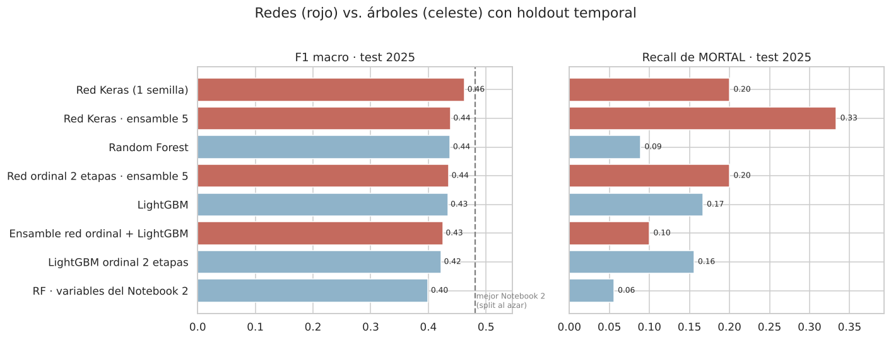

# Red neuronal en Keras para la gravedad de siniestros viales (CABA)

Continúa `../02_modelo_clasificacion_gravedad.ipynb` (sin modificarlo). Clasifica cada siniestro en **LEVE / GRAVE / MORTAL** (94 / 4,5 / 1 %).

- **Holdout temporal:** train 2019-2023, validación 2024, test 2025.
- **Variables nuevas:** agregados de víctimas (sin fecha de fallecimiento ni gravedad de la víctima), tasa histórica de gravedad en el entorno H3 calculada fuera de pliegue, coordenadas, hora y mes en seno/coseno.
- **Red Keras:** embeddings, BatchNorm, Dropout, AdamW, focal loss, early stopping por F1 macro. Ensamble de 5 semillas y variante ordinal en dos etapas.
- **Comparación:** Random Forest y LightGBM en el mismo split.

| Modelo (test 2025) | F1 macro | Recall MORTAL |
|---|---|---|
| RF · variables del Notebook 2 | 0,400 | 0,06 |
| Random Forest | 0,438 | 0,09 |
| LightGBM | 0,434 | 0,17 |
| **Red Keras** | **0,463** | 0,20 |
| Red Keras · ensamble 5 | 0,438 | **0,33** |
| Red ordinal 2 etapas | 0,435 | 0,20 |

Archivos: `04_red_keras_gravedad.ipynb` (ejecutado), `04_red_keras_gravedad.py` (misma fuente, formato jupytext), `resultados_modelos.csv`, `graficos/`. Requiere `tensorflow`, `keras>=3`, `lightgbm`, `h3`, `scikit-learn` y los CSV limpios en la raíz del repositorio (no se versionan).
