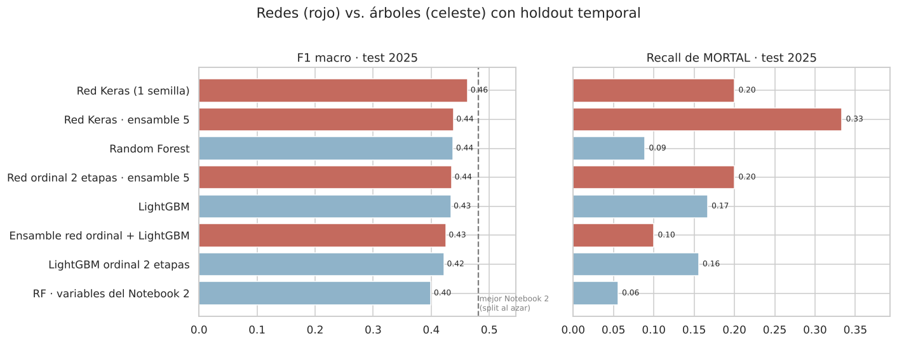
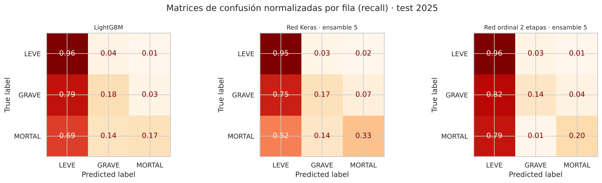
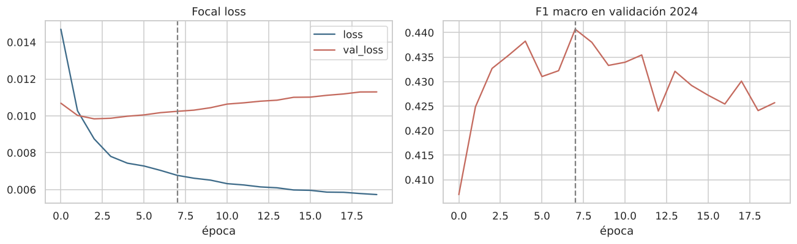
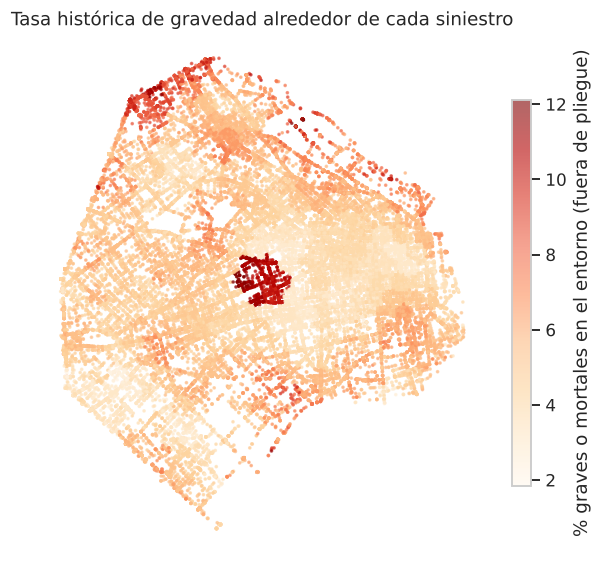
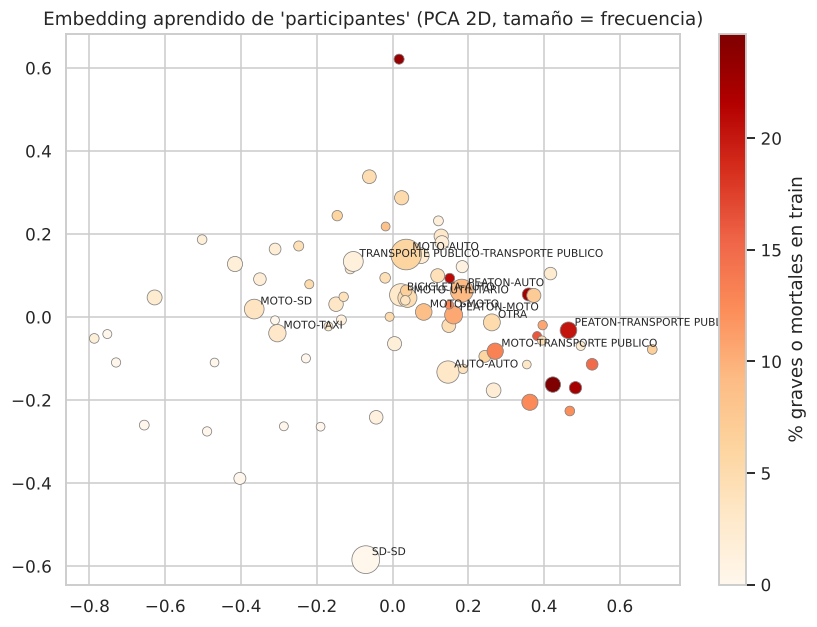
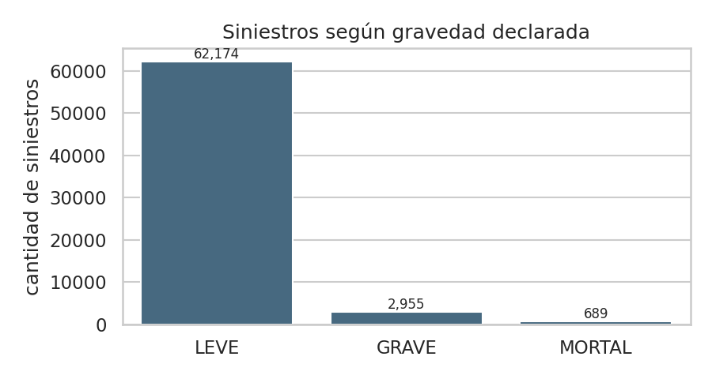
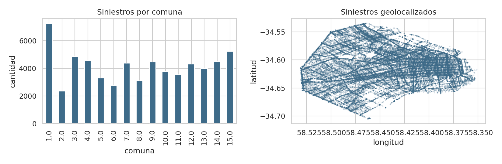

<div align="center">

# 🚦 Siniestros viales en CABA
### ¿Qué hace que un choque sea **leve**, **grave** o **mortal**?

Clasificación de la gravedad de 65.818 siniestros viales de la Ciudad de Buenos Aires (2019-2025) con<br>
Machine Learning clásico, clustering y una **red neuronal en Keras** con embeddings y *focal loss*.




</div>

---

## 🎯 Resumen

| | |
|---|---|
| **Problema** | Clasificación multiclase muy desbalanceada: 94 % LEVE · 4,5 % GRAVE · 1 % MORTAL |
| **Datos** | [Buenos Aires Data · Víctimas de siniestros viales](https://data.buenosaires.gob.ar/dataset/victimas-siniestros-viales) (tablas `hechos` y `victimas`, 1:N) |
| **Métrica** | F1 macro y recall de la clase MORTAL (la que importa para la política pública) |
| **Mejor modelo** | Red Keras: **F1 macro 0,463** en test 2025 (holdout temporal); el ensamble de 5 redes detecta **1 de cada 3 siniestros mortales** (recall 0,33 vs 0,09 del Random Forest) |

## 🗂️ Estructura

```
├── 01_eda_y_limpieza_profunda.ipynb      Diagnóstico de calidad y limpieza
├── 02_modelo_clasificacion_gravedad.ipynb Regresión logística, Random Forest, GridSearchCV
├── 03_clustering_siniestros.ipynb        K-Means, PCA y DBSCAN
├── 04_red_neuronal_keras/                Red neuronal en Keras (embeddings, focal loss, ensamble)
│   ├── 04_red_keras_gravedad.ipynb
│   ├── 04_red_keras_gravedad.py          misma fuente en formato jupytext
│   ├── resultados_modelos.csv
│   └── graficos/
├── informe_eda/graficos/                 Figuras del informe exploratorio
├── practicas/                            Prácticas del curso (NumPy, normalización)
└── requirements.txt
```

## 🧠 04 · Red neuronal en Keras

Continúa el Notebook 2 con un diseño más exigente: **holdout temporal** (train 2019-2023, validación 2024, test 2025), así que los números no son comparables con el split aleatorio del Notebook 2.

- **Variables nuevas:** agregados de víctimas (sin información que filtre la respuesta), **tasa histórica de gravedad del entorno H3** calculada fuera de pliegue, coordenadas, y hora y mes codificados en seno/coseno.
- **Arquitectura:** embeddings para las categóricas, BatchNorm, Dropout, AdamW, **focal loss** y *early stopping* por F1 macro. Ensamble de 5 semillas y una variante ordinal en dos etapas.
- **Comparación justa:** Random Forest y LightGBM entrenados con el mismo split y las mismas variables.

| Modelo (test 2025) | F1 macro | Recall MORTAL |
|---|:---:|:---:|
| RF · variables del Notebook 2 | 0,400 | 0,06 |
| Random Forest | 0,438 | 0,09 |
| LightGBM | 0,434 | 0,17 |
| **Red Keras** | **0,463** | 0,20 |
| Red Keras · ensamble 5 | 0,438 | **0,33** |
| Red ordinal 2 etapas | 0,435 | 0,20 |

<table>
<tr>
<td></td>
<td></td>
</tr>
<tr>
<td></td>
<td></td>
</tr>
</table>

**Lectura:** la red supera a los árboles en F1 macro y, sobre todo, en la detección de siniestros mortales. En el *embedding* aprendido de la combinación víctima-contraparte, las combinaciones más letales (peatón contra transporte público, por ejemplo) quedan juntas hacia la derecha del plano, sin que nadie se lo indique a la red.

## 🔍 01 · Exploración

<table>
<tr>
<td></td>
<td></td>
</tr>
</table>

## Decisiones principales de limpieza

- **El crudo no se modifica.** Todo se hace sobre copias, y cada paso imprime cuántos valores cambió.
- **Normalización de categorías.** Primero tipográfica (espacios, mayúsculas, acentos) y después semántica con diccionarios de equivalencias (`OMNIBUS → COLECTIVO`, `MOTOCICLETA → MOTO`).
- **Valores imposibles a faltante**, sin borrar filas: edad mayor a 110, hora fuera de 0–23, comuna fuera de 1–15.
- **Los faltantes se tratan según lo que significa cada variable.** Las categóricas reciben el nivel `SIN DATOS`. Los conteos vacíos pasan a 0. La edad se imputa con la mediana y queda marcada. La fecha de fallecimiento, las coordenadas y la comuna no se imputan.
- **Los duplicados exactos de `victimas` se conservan**, porque son personas distintas con los mismos atributos.
- **La variable objetivo se deriva de los conteos de víctimas** (MORTAL > GRAVE > LEVE), que se pueden verificar aritméticamente. No se usa la etiqueta de texto.

## 02 · Modelo clásico (Random Forest)

- **Unidad:** el siniestro (65.818 casos). Se excluyen las variables que filtran la respuesta (*data leakage*): conteos por gravedad, gravedad de la víctima y fecha de fallecimiento.
- **Predictoras:** hora, día de la semana, mes, año, cantidad de víctimas, edad media, tipo de vía, modo de desplazamiento, contraparte y comuna (con one-hot).
- **Desbalance:** alrededor de 94 % LEVE, 4,5 % GRAVE y 1 % MORTAL. Por eso se usa una división train/test 80/20 estratificada, `class_weight` y **F1 macro** como métrica principal.
- **Optimización:** `GridSearchCV` con validación cruzada estratificada de 3 pliegues.

### Resultados en test

| Modelo | Accuracy | Precision macro | Recall macro | F1 macro |
|---|---|---|---|---|
| Línea de base (siempre LEVE) | 0,944 | 0,315 | 0,333 | ≈ 0,32 |
| Regresión Logística (optimizada) | 0,641 | 0,374 | 0,606 | 0,343 |
| Random Forest (sin restricciones) | 0,944 | 0,497 | 0,346 | — (sobreajusta) |
| **Random Forest (optimizado)** | 0,899 | 0,457 | 0,542 | **≈ 0,48** |

**Modelo elegido: Random Forest optimizado** (`min_samples_leaf=5`, `class_weight="balanced_subsample"`). Tiene el mejor F1 macro en validación cruzada (0,484) y en test. La Regresión Logística detecta más casos graves y mortales (recall 0,46 y 0,71), pero da demasiadas falsas alarmas (precision de 0,10 y 0,05). El Random Forest equilibra mejor la detección y la precisión.

### Hallazgos

- La proporción de siniestros graves o mortales **se triplica de madrugada**: alrededor de 16 % a las 3 h, contra 4 % a la tarde. También es mayor los fines de semana y en autopistas.
- El **peatón** es la víctima más expuesta, seguido por la moto y el monopatín. Chocar contra un **objeto fijo** es lo más grave, y el **camión** concentra la mayor proporción de siniestros mortales.
- La categoría `SIN DATOS` aparece casi siempre en siniestros leves, porque esos casos se registran con menos detalle. Es un sesgo de la fuente que el modelo también aprende.

## 03 · Clustering (K-Means)

- **Algoritmo:** K-Means sobre las circunstancias del siniestro (hora, día, cantidad y edad de las víctimas, tipo de vía, modo de la víctima y contraparte). La gravedad no se usa para agrupar, sólo para validar.
- **Modelo base:** todo estandarizado. Los grupos se armaban por una sola categoría rara, sin codo claro e inestables entre semillas (ARI 0,41).
- **Mejora:** `nocturno` (21 a 5 h) y `fin_de_semana` en lugar de la hora y el día, indicadoras sin estandarizar, categorías con menos del 2 % agrupadas en `OTRO` y PCA al 80 % de la varianza.
- **Criterio de selección:** estabilidad (ARI ≥ 0,95), ningún grupo menor al 2 % y mayor silueta → **k = 6** (silueta 0,38, ARI 1,00).
- **Validación:** silueta por punto y comparación con DBSCAN, que fragmenta los datos (60 a 112 grupos) o junta el 62 % en un solo grupo, con silueta ≤ 0,32.
- **Hallazgo:** el grupo de **personas mayores** (edad media 62 años) tiene 2,6 % de siniestros mortales, dos veces y media el promedio; los siniestros de día hábil, de día, son los más leves.

## 🔒 Datos

Los datos **no se versionan** en este repositorio (el `.gitignore` excluye CSV, Parquet, Excel, PDF, modelos serializados, etc.). Son datos abiertos del GCBA y se descargan desde la fuente:

1. Bajar `siniestros_viales_hechos.csv` y `siniestros_viales_victimas.csv` desde [Buenos Aires Data](https://data.buenosaires.gob.ar/dataset/victimas-siniestros-viales).
2. Dejarlos en la raíz del repositorio.
3. Correr `01` y `02`, que generan `hechos_limpio.csv` y `victimas_limpio.csv`; el resto de los notebooks parte de esos archivos.

## ▶️ Cómo reproducir

```bash
git clone https://github.com/santiagonicolasruiz/santi_trabajo_data_science.git
cd santi_trabajo_data_science
pip install -r requirements.txt
jupyter lab
```

También corre en Google Colab subiendo los CSV a la sesión.

## 👤 Autor

**Santiago Ruiz** · Economista y analista de datos · [GitHub](https://github.com/santiagonicolasruiz) · [LinkedIn](https://linkedin.com/in/santiago-ruiz-180373127)
